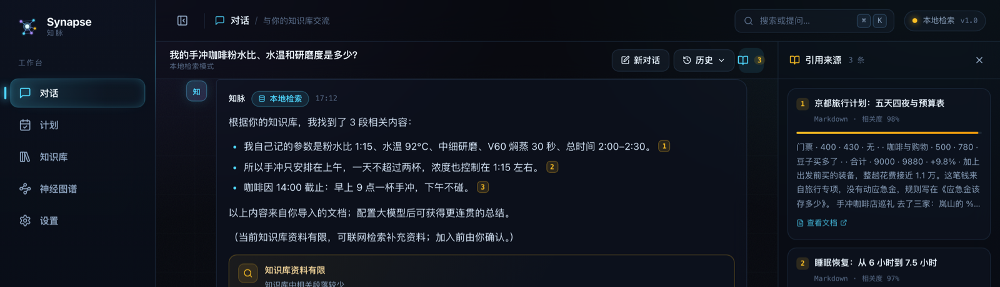
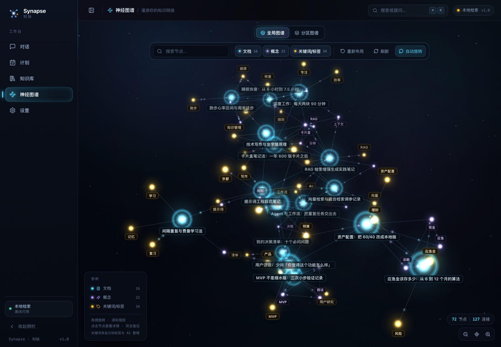
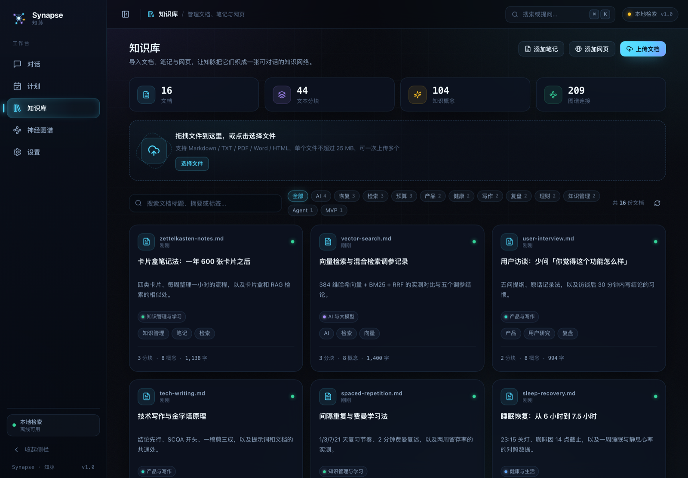
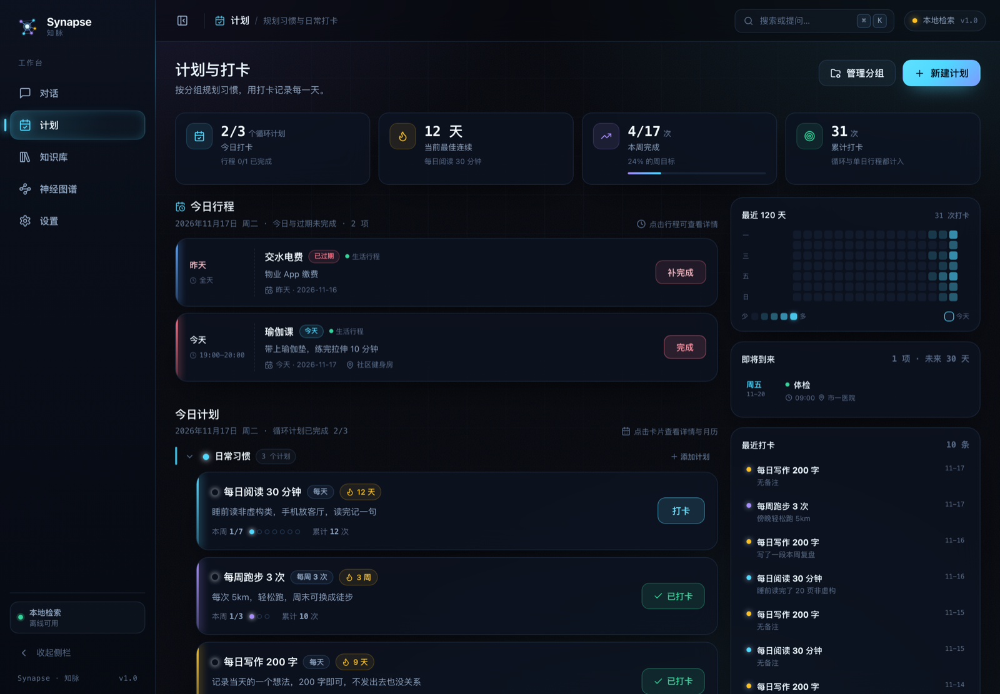
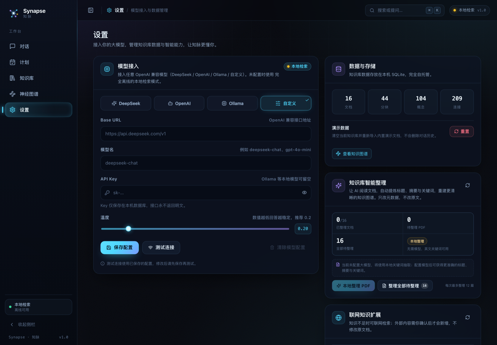
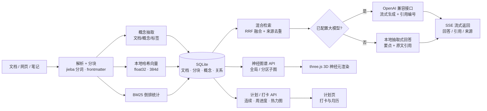

<div align="center">

# Synapse · 知脉

**让知识，像神经元一样连接。**

基于文档的 AI 助手 · RAG 问答与引用溯源 · 神经元式个人知识图谱
自托管 · 中文优先 · 无需 API Key 也能离线运行

[](https://github.com/15016623369a-spe/synapse-zhimai/actions/workflows/ci.yml) [](https://github.com/15016623369a-spe/synapse-zhimai/releases)


</div>

---

## 这是什么

Synapse 把一个文件夹里的个人笔记、PDF、Word、网页和随手写下的想法，变成一个**可以对话、可以漫游的第二大脑**：

- **问它**：基于你的文档回答问题，每个结论都标注引用来源，不编造；
- **连它**：把文档、概念、标签组织成一张会呼吸的「神经元」知识图谱；知识太多时，用**分区图谱**把相关内容收进独立知识岛，隔离无关信息；
- **养它**：持续导入新文档，知识库、对话与图谱实时更新；
- **坚持它**：在「计划」页制定每日/每周计划，像打卡一样记录完成情况，用连续天数、周进度与热力图把想法变成习惯；
- **补它**：资料不足时让 agent 联网搜索补充，结果由你审核后才作为**额外知识**入库，不改原文档；你的采纳/忽略会被记住。




<p align="center"><i>基于文档的回答与引用来源；无需 API Key 也可运行</i></p>



<p align="center"><i>3D 神经元图谱：拖拽旋转 / 滚轮缩放 / 自动旋转（文档 · 概念 · 标签）</i></p>

| 知识库管理 | 计划与打卡 | 模型与工具设置 |
|---|---|---|
|  |  |  |

> 以上截图基于内置 demo 知识库与 demo 计划，移除了个人文档、对话与截图；验收日志不随开源仓库发布。

---

## 30 秒看闭环

[](docs/media/demo-loop.webm)

1. **答不上**：问题里的实体不在知识库 → 明确说没找到，并给出建议检索词；
2. **你审核**：外部候选只作为待确认资料，勾选后才入库，原文档零修改；
3. **再问答上**：新文档进入检索，回答带引用、可回原文。

20 道缺口题的实测闭环收敛率 **75%（15/20）**，复问引用到新文档 17/20；口径与失败分析见 [docs/EVAL.md](docs/EVAL.md)。

---

## 核心特性

| 能力 | 说明 |
|---|---|
| 📥 **多源知识导入** | Markdown / TXT / PDF / DOCX / HTML / 网页 URL / 纯文本笔记，自动解析、分块、抽取概念 |
| 💬 **有据可查的问答** | 混合检索（BM25 + 本地向量 + RRF 融合）召回上下文，流式回答，逐条标注 `[n]` 引用，可展开查看原文片段 |
| 🎯 **检索完整召回优化（v2.3）** | 文档级两阶段召回（文档打分 + chunk 配额）+ 查询意图路由（set/compare/multi/fact）+ 多查询合并；10 题演示集上平均期望文档召回率 77%→90%（n=10，口径与局限见下文）、Q9 1/5→5/5、Q8 1/5→3/5；单文档 Top-1 不退化 |
| 🧠 **3D 神经元知识图谱** | three.js/WebGL 体积感力导向网络：拖拽旋转、滚轮缩放、自动旋转开关、双击复位、发光节点、突触脉冲、邻居高亮与主题追问 |
| 🗂️ **分区知识图谱** | 手动把相关文档归档到「分区」，每个分区生成独立的 3D 知识岛；全部区域时岛间留白、互不连线，点区域 chips 可单区隔离，适合管理大量知识 |
| 📅 **个人计划与打卡** | **分组管理**计划（如日常习惯 / 生活行程）；支持每日 / 每周循环计划 + **特定日期的单日行程**（可带时间、地点），一键打卡/完成 + 可选备注；自动计算连续天数、周进度与 120 天热力图；月历补记/撤销、编辑删除 |
| 🌐 **联网知识扩展（工具调用）** | **引用文档原文总结**（问题提到知识库论文/文档时自动定位并基于全文回答，不再误判资料不足）；资料真的不足时 LLM 可调用 `search_web` 工具，**学术意图优先 arXiv/OpenAlex**、网页结果过滤社区低质来源；候选带相关度/来源类型，默认只勾选高相关，经你确认后才作为**新文档**加入（tag `外部扩展`），原文档零修改；采纳/忽略会被记住 |
| 📄 **PDF/文档理解与知识整理** | PDF 解析后自动分块、embedding、抽取概念；**AI 智能整理**再从正文提炼正式标题、中文摘要、8–12 个中英关键词与 3–5 个 tag（无 LLM 时本地中英 keyphrase 回退）；关键词进入图谱作为金色节点连接论文/笔记；只改元数据，不改原文/分块/向量 |
| 🧠 **多轮上下文（少而准）** | 追问（「创新点呢」「继续」等）自动继承上一轮文档/主题，用**紧凑上下文卡片**驱动检索：context ≤150 字、token budget ~58、history 仅 4 条；非总结追问只做 doc-scoped top_k=8，不注入全文；扩展搜索 query 自动带上论文标题/实体，不再用「novelty/innovation」泛词 |
| 🔌 **MCP 工具接入 + 添加工具** | 作为 MCP Client 连接外部工具；内置文件系统 / SQLite 知识库 / GitHub 三个**只读** Server；设置页支持**「添加工具」**：AI 帮我配（从受控目录推荐配置）或手动注册任意 stdio MCP Server；测试连接、勾选 allowed_tools 后才启用；路径逃逸/SQL 注入防护、GitHub Token 脱敏；对话命中意图自动调用并展示工具卡片 |
| 📷 **扫描 PDF OCR** | 文本层不足时自动用 PyMuPDF 200dpi 渲染 + RapidOCR 识别（中文/英文，最多 30 页），OCR 文本入库/检索；文本型 PDF 不触发；不可用时清晰降级 |
| 🧬 **真实语义 embedding** | 支持本地哈希（兼容旧库）/ 本地语义模型 fastembed（多语言 MiniLM，384 维）/ OpenAI 兼容 Embeddings API；切换后一键重建全部向量；失败回退，不破坏旧索引 |
| 🎯 **反馈驱动 Reranker** | 读取你对联网候选的采纳/忽略，按 host 偏好、URL、内容相似度做规则化重排；候选显示「你曾忽略/偏好类似来源」；可解释、不训练模型、不删除反馈 |
| ⏰ **定时知识巡检** | 后台每 N 小时检查知识库：自动整理待整理文档（默认每次 3 篇）、检测重复标题/过时/未分区/过短/无标签；报告与下次时间可在设置查看；只改元数据、不自动联网/不改原文 |
| 🔌 **任意大模型可插拔** | 兼容 OpenAI / DeepSeek / Ollama / vLLM 等任意 OpenAI 协议服务，可在设置页随时配置；**不配置也完整可用** |
| 🔒 **本地优先、数据不出门** | SQLite 存储、本地哈希向量 + jieba 中文分词，全程离线；只有你主动配置的大模型请求才会出网 |
| 🎨 **为截图而生的界面** | 深空神经暗色设计系统、流式打字、引用抽屉、骨架屏与完整空/错状态 |

### 两种回答模式

- **AI 生成模式**：配置任意 OpenAI 兼容模型后，由大模型基于检索到的资料生成回答，语气自然、支持多轮对话，并强制标注引用。
- **本地检索模式**：零配置、零联网。用 BM25 + 本地向量检索出最相关的段落，提取要点并附上来源与原文，保证「打开就能用、答案有依据」。

---

## 快速开始

### 环境要求

- macOS / Linux（Windows 可手动起前后端）
- Python ≥ 3.10、Node.js ≥ 18（推荐 20+）
- 可选：[uv](https://github.com/astral-sh/uv)（更快安装依赖；没有也会自动回退 pip）

### 一键启动

```bash
cd synapse
./start.sh
```

首次运行会自动创建虚拟环境、安装依赖、构建前端，然后打开：

**http://127.0.0.1:7800**

启动时若数据库为空，会自动导入 `data/demo_docs/` 中的演示知识库（可以马上体验问答与图谱）。想换成自己的知识：把文档放进 `data/demo_docs/` 重新初始化数据库，或者直接在「知识库」页上传。

### 使用 Docker 一键启动

适合不想在宿主机装 Python/Node，或想快速在另一台机器上跑起来：

```bash
docker compose up --build
# 打开 http://127.0.0.1:7800
```

- 默认只绑定 **127.0.0.1**，不会暴露到局域网/公网；数据保存在命名卷 `synapse-data` 中。
- 在 `.env` 中可设置 `SYNAPSE_PORT`、`SYNAPSE_LLM_*`、`SYNAPSE_SEARCH_PROVIDER` 等；`docker compose` 会自动读取项目根 `.env` 做变量替换。
- 数据备份/恢复（在项目根执行）：

```bash
# 备份
docker compose exec synapse tar czf - -C /app/data . > synapse-data-$(date +%Y%m%d).tgz
# 恢复前先停服务；恢复后重启
docker compose down
docker compose up -d
# 如需重置为演示数据（会先备份 DB）：
docker compose exec synapse python scripts/reset_demo.py --yes
docker compose restart
```

- **安全提醒**：镜像本身没有登录/多用户隔离，不要直接映射到公网；远程访问请用 VPN 或带认证/TLS 的反向代理，详见 [SECURITY.md](SECURITY.md)。

### 开发模式（前后端热更新）

```bash
./dev.sh          # 后端 :7800（--reload） + 前端 :5173
```

### 接入大模型（可选）

网页右上角/设置页填入任意 OpenAI 兼容服务即可：

| 服务 | Base URL | 模型示例 |
|---|---|---|
| DeepSeek | `https://api.deepseek.com/v1` | `deepseek-chat` |
| OpenAI | `https://api.openai.com/v1` | `gpt-4o-mini` |
| Ollama（本地） | `http://127.0.0.1:11434/v1` | `qwen2.5:7b` / `llama3.1:8b` |
| vLLM / LM Studio | 你的服务地址 | 你的模型名 |

也可以写进 `synapse/.env`（复制 `.env.example`）：

```bash
SYNAPSE_LLM_BASE_URL=https://api.deepseek.com/v1
SYNAPSE_LLM_API_KEY=sk-...
SYNAPSE_LLM_MODEL=deepseek-chat
```

> API Key 只保存在本地 SQLite，接口返回永远只显示「已配置」，不会回传明文。

### 导入自己的文档

- **上传**：知识库页拖拽或选择文件（md / txt / pdf / docx / html，单文件 ≤ 25MB）
- **网页**：点「添加网页」填 URL，自动抓取正文
- **随手记**：点「添加笔记」直接写 Markdown
- **批量**：把文件放进 `data/demo_docs/`，删除 `data/synapse.db` 后重启，即自动重新索引

Markdown 支持简单 frontmatter（可选）：

```markdown
---
title: 我的 RAG 实践笔记
tags: ["AI", "RAG"]
summary: 一句话摘要
---
```

---

## 界面与交互

| 页面 | 你能做什么 |
|---|---|
| **对话** | 欢迎语 + 快捷提问、流式回答、Markdown 渲染、复制、停止生成、历史会话切换、右侧引用来源原文 |
| **计划** | 总览统计、今日计划卡片、一键打卡（可写备注）、连续/周进度、120 天热力图、最近打卡、计划详情月历（补记/撤销）、新建/编辑/删除；内置 3 个模板快捷开始 |
| **知识库** | 统计总览、拖拽上传、网页/笔记录入、搜索与标签筛选、文档详情与分块预览、删除重建 |
| **3D 神经图谱** | 鼠标拖拽旋转视角、滚轮缩放、自动旋转开关、双击复位、搜索节点并平滑聚焦、按类型筛选、hover 高亮邻居、点击节点查看关联文档与片段、一键「就这个主题提问」 |
| **设置** | 模型接入与连通性测试、清除配置、演示数据重置、版本与技术栈信息 |

### 分区图谱：把知识收进独立的知识岛

当知识库变大、全局图谱太密时，切到图谱页顶部的 **「分区图谱」**：

1. **建分区**：点「管理分区」→ 输入名称、选颜色、创建（例如「AI 与大模型」「健康与生活」）。
2. **归档文档**：在「文档归档」里搜索/勾选文档，选择目标分区，点「应用」——支持多选、批量移入或移出（移出即未分区）。
3. **看隔离图谱**：默认「全部区域」把所有分区渲染成互不连接、彼此留白的 3D 知识岛；点某个区域 chip 或岛上的区域标签，就只显示该分区的知识，其他分区完全隔离。
4. **随改随生效**：改名、删除分区、调整归档后图谱即时刷新；**删除分区不会删除文档**，只会让其中的文档回到「未分区」。

> 当前工作区已按主题预置 5 个分区（AI 与大模型 / 知识管理与学习 / 产品与写作 / 健康与生活 / 理财与决策），你可以随时在「管理分区」里改名、移动文档或删掉重来。

### 计划与打卡：分组管理，既能循环也能单日安排

左侧导航进入 **「计划」**：

1. **管理分组**：点右上角「管理分组」创建分组（如「日常习惯」「生活行程」），选颜色、写描述；删除分组只会把计划移回「未分组」，不会删除计划与打卡。
2. **循环计划**：在分组区块（或空分组的「添加计划」入口）新建「循环计划」——每天 / 每周 N 次，挑颜色、开始日期与所属分组。
3. **单日行程**：新建时切到「单日行程」，设置**特定日期** + 可选起止时间、地点与分组；它会出现在当天「今日行程」或右侧「即将到来」。
4. **打卡 / 完成**：循环计划一键打卡（可写备注、撤销）；单日行程在当天点「完成」，过期未完成可补完成，未来行程不能提前完成。
5. **看进展**：顶部统计今日打卡/行程完成、当前最佳连续、本周完成与累计；右侧 120 天热力图与最近打卡记录。
6. **复盘与调整**：计划详情里可补记/撤销过去日期、查看备注、编辑或删除计划。

> 当前工作区预置了 2 个分组（日常习惯 / 生活行程）、3 个循环计划与 3 个单日行程（瑜伽课 / 体检 / 交水电费）及演示打卡记录，可在详情里编辑或删除，也欢迎全部换成自己的安排。

### 联网知识扩展：缺什么补什么，由你拍板

当你的知识库资料不足时（例如问一个完全没收录的主题）：

1. **缺口提示**：回答下方出现「知识库资料有限」提示卡，并给出建议检索词。
2. **工具调用搜索**：配置大模型后，agent 可通过 `search_web` 工具自动联网检索（默认 Bing 网页搜索，无需 API Key）；回答会用 `[W1]` 等标注外部资料，并展示「外部参考 · 未入库」。
3. **由你审核入库**：点「查看并选择加入知识库」打开 **「知识扩展 · 由你确认」** 面板——勾选资料、可选加入哪个分区、也可手动粘贴 URL；点确认后才会被加入知识库。
4. **只增不改**：新增内容全部是**新文档**（`source_type=web`、tag `外部扩展`、带原始 URL），原文档/分块/ID 完全不变；新知识会自动参与后续检索、图谱与问答。
5. **引用文档智能识别**：当问题提到知识库里的具体论文/文档（书名号标题、文件名、arXiv ID，甚至大小写/拼写有差异）时，agent 会自动定位该文档，**直接基于全文总结**（不再误判「资料不足」，消息头部显示「知识库文档《…》」标签），完全不需要联网。
6. **学术来源优先**：确实需要外部补充时，识别论文/arXiv/DOI 意图，优先使用 **arXiv API / OpenAlex** 并给候选标注「学术 / 官方 / 百科 / 媒体 / 社区」；网页搜索结果会按**相关度 + 来源质量**过滤，低相关/社区低质内容默认不展示；学术候选可显示 PDF 链接。
7. **反馈会被记住**：被忽略的链接不再推荐；采纳/忽略计数可见——这是本版本的「轻量 RL」：**反馈式知识扩展闭环，不训练模型**。真正的模型微调/强化学习不在本版本范围。
8. **可替换搜索源**：默认 Bing + arXiv/OpenAlex；也可在 `.env` 配置自建 SearXNG（`SYNAPSE_SEARXNG_URL`）或测试用 mock provider。

### PDF / 文档理解：能入库，也能提炼关键词

- **支持格式**：PDF、Markdown、TXT、DOCX、HTML、网页 URL、手记；PDF 会被解析成文本、按结构分块、生成本地 embedding 并进入检索/图谱（不是只存文件）。
- **新上传 PDF 更干净**：自动去掉跨页页眉/页脚/页码、修复 `train- ing` 这类断词、从首页/metadata 提取正式标题；入库后自动做一次 AI 整理（`SYNAPSE_AUTO_ENRICH=1`，可用环境变量关闭）。
- **存量文档也能变聪明**：设置页「知识库智能整理」→「智能整理 PDF / 整理全部待整理」，AI 会读正文并生成 **正式标题、中文摘要、8–12 个中英关键词、3–5 个 tag**；没有配置模型时用本地中英关键词算法回退。整理**只改元数据**，`content / chunks / embedding` 完全不变（验收时做了 sha256 对比）。
- **图谱里能看见关键词**：关键词以金色 tag 节点显示（完整词/悬浮提示），高连接概念也有小标签；共享「多目标跟踪 / Transformer / 因子图 / 信念传播」等关键词会把论文和笔记连起来。
- **PDF 问答更靠谱**：在问题里引用文档标题（书名号）、文件名或 arXiv ID，agent 会识别该文档并使用**全文**总结/答疑，不再误判资料不足；也支持从知识库「就这篇文档提问」。

### V2 新能力：工具、OCR、真实向量、反馈排序、自动巡检

- **MCP 工具**：设置 →「MCP 工具」，可启用文件系统（默认只读 `data/`）、SQLite 知识库（只读 SELECT）、GitHub（需 Token）。对话里直接说「列出数据目录下的 Markdown 文件」或「查询 documents 表有多少篇文档」，agent 会自动调用对应工具并展示「工具调用」卡片；所有内置工具只读，路径逃逸/写 SQL 会被拒绝。
- **添加工具（AI 帮我配）**：MCP 卡右上角「添加工具」→ 描述需求（如「读取本地文件」「网页抓取」），AI 只从后端受控目录推荐配置（不执行命令、不自动安装）；内置建议直接启用现有 preset，自定义建议预填表单，测试连接、勾选允许工具后才启用；也可以手动填写任意 stdio MCP Server 的命令/参数/env。
- **扫描 PDF OCR**：新上传的扫描版 PDF 无文本层时自动 OCR（RapidOCR，最多 30 页）；设置页「语义向量」卡会显示 OCR 就绪状态。存量 PDF 需要重新上传才能重解析。
- **真实语义向量**：设置 →「语义向量」选择「本地语义模型」→ 保存并「重建全部向量」（当前 1538 chunks 约 29 秒）；也可接 OpenAI 兼容 embeddings API。重建只改向量，不动原文。
- **反馈 Reranker**：你在知识扩展里点过的「加入/忽略」会实时影响后续候选排序；设置 →「反馈偏好」查看已学到的优先/降权来源。规则化偏好，不是模型训练。
- **定时知识巡检**：设置 →「知识巡检」开启（默认 24h）；自动整理待整理文档、发现重复/过时/未分区/过短/无标签问题；后台调度随服务运行，关闭开关即停止。巡检不会自动联网，也不会自动新增外部文档。
- **多轮上下文（少而准）**：追问「创新点呢」会自动继承上一轮的论文/文档，消息头部显示「已结合上文《…》」，直接基于文档回答，不再误报资料不足；扩展面板也会显示「已结合上文」，query 含论文标题/实体。上下文卡片控制在 ~132 字 / ~58 token，历史只带最近 4 条、不注入全文（仅明确「总结/全文」才加载完整文档上下文）。

### 检索完整召回（v2.3）

- **文档级两阶段**：不是只看 Top-K chunk，而是先对文档打分（最佳 chunk + top2 均值 + 标题/标签/摘要/稀有词），再按文档配额轮转选 chunk；多文档问题不会再被单篇文档占满。
- **查询意图路由**：自动识别 `set`（哪些/列出/所有）、`compare`（区别/对比）、`multi`（并且/分别/关系）、`fact`（普通事实题），不同模式用不同文档数/片段配额。
- **多查询合并**：对比/复合问题会生成最多 3 条确定性检索 query（不调 LLM），合并去重后再排序。
- **稀有词/精确词保护**：命中高 IDF 稀有词、标题/标签/摘要的文档获得额外加分，不容易被语义泛化挤掉。
- 实测（10 题演示集，n=10）：平均每题期望文档召回率 **77% → 90%**，MRR **0.905 → 0.944**，Q9（预算）**1/5 → 5/5**，Q8 **1/5 → 3/5**；单文档 Top-1 不退化；API 旧字段兼容。
- **口径说明**：上面是「平均每题期望文档召回率」，来自 10 题 / 16 篇文档的演示集，不是通用准确率。`scripts/eval_retrieval.py` 现在同时输出 doc hit-rate、平均期望文档召回与 MRR；2026-11-20 在 16 篇 demo 库上复跑为 **recall 0.922 / MRR 1.000（n=9）**，与 v2.3 的 90.0% / 0.944 不完全一致（v2.3 用的是 34 篇 live 库，且 Q9 标签已过期：当前库实际 13 篇含「预算」，旧期望只列 5 篇）。这些数字只适合做回归趋势，对外引用前请先看 [docs/VERIFICATION.md](docs/VERIFICATION.md)。

---

## 工作原理



**检索**：查询先用 jieba 分词并生成查询向量；BM25 与向量 cosine 各召回候选，用 Reciprocal Rank Fusion 融合排序，同一文档最多保留 2 个片段，最终取 Top-K 作为上下文。

**回答**：AI 模式下把编号资料与最近对话历史交给大模型，system prompt 强制「只基于资料回答 + 每个结论标注编号 + 信息不足要明说」；本地模式抽取最相关句子组成要点式回答。两种模式都会返回结构化引用（文档名、片段、相关度），前端在回答下方展示可展开的「参考来源」。

**图谱**：入库时为每篇文档抽取概念并建立 `mentions / tagged / related / cooccur` 四类关系，接口按节点度数裁剪后返回；前端用 three.js/WebGL + 自研 3D 力导向绘制可旋转的神经元网络。分区模式下接口按文档所属区域拆成互相隔离的子图（概念/标签按区重复、跨区零连线），前端把每个分区布局成独立的 3D 知识岛。

---

## 技术栈

- **后端**：Python 3.12 · FastAPI · Uvicorn · SQLite（标准库 sqlite3）· httpx · jieba · pypdf · python-docx · BeautifulSoup · NumPy
- **检索**：BM25 + 本地 hash n-gram 向量（384 维）· RRF 融合 · 概念 TF-IDF
- **前端**：React 19 · TypeScript（strict）· Vite 6 · three.js（WebGL 3D 图谱）· d3-force（列表/回退）· react-markdown · lucide-react
- **联网扩展**：OpenAI 兼容 tool calling（`search_web`）· Bing 网页搜索（HTML 解析）· arXiv/OpenAlex 学术检索 · 自建 SearXNG 可选 · httpx + BeautifulSoup 正文抓取
- **文档理解**：pypdf 解析 + 断词/页眉页脚清洗 · LLM 抽取标题/摘要/关键词 · 本地中英 keyphrase 回退 · 关键词/概念图谱
- **V2 扩展**：MCP Python SDK（stdio）· FastMCP 内置只读 Server · fastembed（多语言 ONNX，本地语义向量）· OpenAI 兼容 Embeddings · 反馈规则化 Reranker · asyncio 巡检调度器
- **测试**：pytest · Playwright

```text
synapse/
├── backend/            FastAPI 服务、RAG 管线、SQLite 数据层、pytest
│   └── app/{routers,services}/...
├── frontend/           React + Vite 单页应用
│   └── src/{views,components,lib}/...   # 含 plans/ 计划页与分区图谱
├── demo/               闭环演示（本地 fixture + Playwright 录制）
├── data/               演示知识库（Markdown）与评测问题
├── eval/                MultiHop-RAG 公开基准评测 + 闭环收敛率（隔离数据目录）
├── scripts/            端到端自检、检索评估、OpenAI 兼容 mock LLM
├── SPEC.md             产品规格 + API 契约（开发用）
├── start.sh / dev.sh   一键启动 / 开发模式
├── docs/screenshots/   演示截图（基于 demo 数据）
└── README.md
```

---

## API 一览

完整契约见 [`SPEC.md`](SPEC.md)；启动后可访问 `http://127.0.0.1:7800/api/health` 自检。

| 分类 | 端点 |
|---|---|
| 健康 | `GET /api/health` |
| 文档 | `GET/POST /api/documents*`（列表、上传、文本、URL、详情、分块、删除） |
| 检索 | `POST /api/search` |
| 对话 | `POST /api/chat`（SSE 流式）、`GET /api/conversations*` |
| 图谱 | `GET /api/graph`、`GET /api/graph/node?id=…` |
| 设置 | `GET/PUT /api/settings`、`POST /api/settings/test` |
| 统计 | `GET /api/stats` |

---

## 测试与验证

```bash
# 后端单元/接口测试
cd backend && .venv/bin/python -m pytest -q

# 端到端 API 契约自检（需服务已启动）
backend/.venv/bin/python scripts/check_api.py http://127.0.0.1:7800

# 检索质量评估（演示问题命中率 / 关键词覆盖率）
backend/.venv/bin/python scripts/eval_retrieval.py http://127.0.0.1:7800

# 多格式入库冒烟（md / txt / html / docx / 网页 URL）
backend/.venv/bin/python scripts/smoke_ingest.py http://127.0.0.1:7800

# 一键预置分区 / 分区图谱浏览器验收（需 Playwright）
backend/.venv/bin/python scripts/setup_zones.py http://127.0.0.1:7800
scripts/e2e_zones.py http://127.0.0.1:7800

# 一键预置示例计划 / 计划页浏览器验收（需 Playwright）
backend/.venv/bin/python scripts/setup_plans.py http://127.0.0.1:7800
scripts/e2e_plans.py http://127.0.0.1:7800

# 一键预置计划分组 + 单日行程 / 分组页浏览器验收（需 Playwright）
backend/.venv/bin/python scripts/setup_plan_groups.py http://127.0.0.1:7800
scripts/e2e_plan_groups.py http://127.0.0.1:7800

# 联网知识扩展 UI 验收（真实 Bing + 真实 LLM，不写入知识库；需 Playwright）
scripts/e2e_extend_ui.py http://127.0.0.1:7800

# 前端类型检查与构建
cd frontend && npm run typecheck && npm run build
```

实测结果（2026-11-20；验收脚本位于 `scripts/`，日志含个人数据、不随仓库发布；历史记录见 [docs/VERIFICATION.md](docs/VERIFICATION.md)）：

| 检查 | 结果 |
|---|---|
| 后端 pytest（断网） | **362 passed / 1 skipped** |
| API 契约自检 | **54 / 54 PASS**（v2.4 新增引用/缺口检查） |
| 演示问题检索 | **10/10 命中**，关键词覆盖 81%（doc hit-rate，非通用准确率） |
| 多格式入库 | **5 / 5 成功且可检索** |
| 前端 typecheck / build | **0 error / 构建成功** |
| Playwright 端到端（2D 版本） | **23 / 23 PASS**，0 console error、0 API 4xx/5xx |
| 3D 图谱专项验收 | **16 / 16 PASS**（WebGL 渲染 / 自动旋转 / 拖拽旋转 / hover / 搜索聚焦 / 1024px / 四页回归 / 0 console error） |
| API 契约回归（含分区） | **52 / 52 PASS** |
| 分区图谱专项验收 | **19 / 19 PASS**（空态 / 新建 / 归档 / 图隔离 / 单区 / 重命名 / 删除 / 1024px / 0 console error） |
| 计划与打卡专项验收 | **20 / 20 PASS**（总览 / 打卡+撤销 / 新建/编辑/删除计划 / 月历 / 1024px / 其他页回归） |
| 计划分组 / 单日行程专项验收 | **18 / 18 PASS**（分组增删改 / 组内建计划 / 删除分组保留计划 / 行程完成+撤销 / 单日行程表单 / 1024px / 0 console error） |
| 联网知识扩展专项验收 | **11 / 11 PASS**（真实 gap 卡 / 真实工具搜索外部参考 / 真实 Bing 候选面板 / 设置状态卡 / 0 console error / 未写入知识库） |
| 知识扩展相关性修复（v1.6） | **168 后端测试过**；live 引用文档全文总结（无 gap/外网调用）、arXiv 250 候选 relevance 95%/authority academic、普通缺失问题过滤掉无关候选、0 console error |
| PDF 理解与知识整理（v1.7） | **187 后端测试过**；8 篇 PDF 真实 AI 整理（14.5s/8 成功）、标题/摘要/关键词/tags 改善；图谱关键词节点 34→60；8 篇 PDF 的 content/chunks/embedding sha256 整理前后一致 |
| V2 五项 + 上下文 + MCP 添加工具 + 检索 V3（v2.3） | **342 passed / 1 skipped**；MCP 真实验证（文件系统 17 文件、SQL 31 篇，无多余 gap）；OCR 2 页扫描件入库；fastembed 重建 1538 chunks/28.9s；巡检自动整理 3 篇；Reranker 0 采纳/8 忽略；API 52/52、3D 16/16；前端 mock 79/0、真实 38/0、集成 28/0 |

详细验收方法与指标见 [docs/VERIFICATION.md](docs/VERIFICATION.md)；日志与个人截图保存在本地 `private/`（已 gitignore），不随开源仓库发布。

---

## 公开基准评测（MultiHop-RAG）

效果不再用「10 题演示集」证明。在公开基准 [MultiHop-RAG](https://huggingface.co/datasets/yixuantt/MultiHopRAG)（ODC-BY，609 篇英文新闻 / 2556 题）上：

| 指标 | 结果 | 说明 |
|---|---:|---|
| doc hit@10（可答题） | **82.7%** | top-10 至少命中一篇期望文档 |
| doc recall@10（可答题） | **54.4%** | 多证据题取平均；随机基线 ≈ 1.6% |
| complete@10 | **27.5%** | 多篇证据全部进 top-10 的题占比 |
| MRR@10（可答题） | **58.4%** | 第一篇期望文档的排名 |
| 缺口误报 / 未答题标记 | **9.7% / 86.1%** | 强缺口误报 / null 题被强缺口或弱提示标记 |
| 闭环收敛率 LCR | **85%**（17/20） | 采纳外部知识后由「答不上」变「答得上」 |

题型拆分、失败分析、已知限制见 [docs/EVAL.md](docs/EVAL.md)；一键复现：

```bash
backend/.venv/bin/python eval/prepare.py
backend/.venv/bin/python eval/evaluate.py --all
backend/.venv/bin/python eval/loop_closure.py --questions 20
```

> 这是英文新闻语料的压力测试，不等于中文个人笔记场景表现；10 题 demo 集只保留为回归冒烟。

---

## 已知限制

Synapse 是单用户、本机优先的工具，不是生产级多租户服务。以下限制是刻意保留的取舍，使用前请确认：

- **无登录 / 多租户**：默认只绑定 `127.0.0.1`，不要直接映射公网；远程访问需要 VPN 或带认证的反向代理。
- **默认向量是词法哈希**：`hash` 模式是 jieba 词 + 字 bigram 的 384 维哈希，同义句余弦接近 0（「如何提高检索召回率」vs「怎么让搜索找到更多相关内容」实测 0.00）。它的价值是零配置、离线可用，不是语义理解；需要语义检索请在设置里切 `fastembed` 或 OpenAI 兼容 embeddings，并重建向量。
- **没有向量索引**：每次查询把全部 chunk 读出来算 BM25 + cosine；1–2k chunk 时 35–60ms，万级 chunk 需要引入 FTS5 / sqlite-vec / FAISS。
- **公开基准数字不算高**：MultiHop-RAG 全量 2556 题上 doc recall@10 54.4%、`complete@10` 27.5%、gap 误报 9.7%、null 标记 86.1%；英文新闻语料对中文分词与阈值不友好，inference 的 complete@10 只有 7.1%。10 题 demo 集（16 篇取 top-8，随机命中约 70%）只做回归冒烟。完整分析与下一步见 [docs/EVAL.md](docs/EVAL.md)。
- **引用校验是保守的 `[n]` 映射**：只保证「回答引用的编号存在于检索结果」，不做 claim-level 的 NLI/忠实度校验；模型仍可能误用某条资料。
- **联网扩展依赖外网**：SSRF 防护会拒绝内网/回环地址；离线环境只能走内置 mock provider，且 mock 候选可能被相关性过滤掉。
- **计划打卡与知识库无耦合**：它是独立的小模块，不参与 RAG；只看知识库能力时可以忽略。
- **单进程调度**：巡检调度器随服务进程运行，多 worker 部署会重复执行。

---

## 与 DocsGPT 的关系 & 路线图

Synapse 的灵感来自 [DocsGPT](https://github.com/arc53/DocsGPT)：同样把「你的文档」变成可对话、可溯源的 AI 助手。区别在于 Synapse 是一个**个人向、单机优先**的实现：默认不依赖 Docker、Postgres、Redis 或独立向量数据库，一个进程 + 一个 SQLite 文件即可运行（也提供可选的 Docker Compose 自托管方式）。

后续可扩展方向：

- [ ] 更多连接器：Notion / Obsidian / GitHub / 语雀，定时同步
- [ ] 真实 embedding 模型接入与可选向量库（pgvector / Qdrant / FAISS）
- [ ] Agent 与工作流：工具调用、多步研究模式
- [ ] 文档内联高亮、引用定位到原文段落
- [ ] 对话分享、导出 Markdown / PDF
- [ ] 多用户与权限（如部署到团队内网）

---

## 更新日志

- **v2.6（2026-11-20）**：检索与拒答提升——英文子问题拆检索（分号 / `, and` / `while`）+ 多查询文档轮转，inference doc recall 0.322→0.378、整体 hit@10 0.778→**0.827**；缺口两级化（强缺口 + 弱提示）+ 单句证据信号，可答题 gap 误报 0.365→**0.097**，null 标记 0.861；闭环收敛率 LCR 0.75→**0.85**（17/20）；新增 30 秒闭环 demo 视频；全量 362 tests。
- **v2.5（2026-11-20）**：公开基准评测——MultiHop-RAG（609 篇 / 2556 题）可答题 doc hit@10 **77.8%**、doc recall@10 **47.2%**、MRR **0.549**、null 拒答 **70.5%**；新增闭环收敛率 LCR 评测（**15/20 = 75%**）；检索支持英文对比意图与多跳文档多样性（multi/compare/set 每篇只取 1 个片段）；英文疑问词进停用词；新增双语测试，全量 **361 tests**。
- **v2.4（2026-11-20）**：闭环可信度修复——缺口检测不再把分词边界误判为缺知识（「咖啡粉水比」不再弹「资料有限」）；引用面板只展示回答里实际出现的 `[n]`，幻觉编号进 `invalid_citations`；低相关片段在进入上下文前过滤（相对 Top-1 + 绝对下限）；文档级引用不再伪造 0.99 分；引用展示改为 高/中/低匹配 + 排名；测试全面禁网（`conftest` 阻断外网 socket），断网 `pytest` **359 passed / 1 skipped**；`documents/url` 补齐逐跳 SSRF 校验；补 `SPEC.md`、`docs/EVAL.md` 与「已知限制」。
- **v2.3（2026-11-17）**：RAG 完整召回优化——文档级两阶段检索 + 查询意图路由（set/compare/multi/fact）+ 确定性多查询；完整召回@8 77%→90%、Q9 1/5→5/5、Q8 1/5→3/5，单文档 Top-1 不退化；全量 342 tests。
- **v2.2（2026-11-17）**：MCP 工具卡新增「添加工具」——「AI 帮我配」从受控目录推荐配置（不自动执行/安装）+ 手动注册 stdio MCP Server；测试连接、工具白名单、启用/删除；全量 325 tests。
- **v2.1（2026-11-17）**：修复多轮上下文丢失——追问自动继承上一轮文档/主题，紧凑上下文卡片（≤150 字、~58 token）、history 4 条/700 字、非总结追问 doc-scoped top_k=8、不注入全文；扩展搜索用上下文生成 query（论文标题/实体）并显示「已结合上文」；新增 23 个测试（全量 313）。
- **v2.0（2026-11-17）**：V2 五项能力——MCP 工具接入（文件系统/SQLite/GitHub 只读）、扫描 PDF OCR、真实语义 embedding（fastembed/OpenAI 兼容 + 1538 向量重建）、反馈驱动 Reranker、定时知识巡检与自动整理；设置页新增 4 张卡，对话支持 MCP 工具调用卡片；后端 290 tests / API 52 / 3D 16 全绿。
- **v1.7（2026-11-17）**：PDF 内容理解与知识整理——PDF 解析清洗/断词/页眉页脚/标题提取增强；新增 AI 智能整理（正式标题/中文摘要/中英关键词/tags）+ 本地 keyphrase 回退；schema 6 增加 enrich_version；图谱显示金色关键词标签与高连接概念；设置页新增「知识库智能整理」；新上传 PDF 自动整理；PDF 提问按文档全文回答（引用识别修复书名号歧义）。
- **v1.6（2026-11-17）**：修复知识扩展相关性——引用文档全文总结（书签/文件名/arXiv ID 识别、拼写容错、40000 字文档上下文、不再误判资料不足）；学术意图优先 arXiv/OpenAlex + 学术白名单；候选相关度/来源权威度打分过滤、前端来源徽标与相关度、默认只选高相关；查询规划校验（不再用「总结/wei」等检索词）。
- **v1.5（2026-11-17）**：新增**联网知识扩展**——知识缺口检测 + LLM `search_web` 工具调用（Bing/SearXNG）、外部参考展示、「知识扩展 · 由你确认」审核面板、手动 URL、加入分区、采纳/忽略反馈记忆（拒绝 URL 不再推荐）；外部知识仅作为**新文档**加入，原知识零修改；SQLite schema_version 5。
- **v1.4（2026-11-17）**：计划体系升级——**计划分组**（新建/编辑/删除分组，计划可归档到分组；删组不删计划）+ **单日行程计划**（特定日期、可选起止时间/地点，今日行程 / 即将到来 / 过期补完成，完成计入热力图）；SQLite schema_version 4，旧数据全部保留。
- **v1.3（2026-11-17）**：新增**个人计划与打卡**——每日/每周计划、打卡备注、连续天数/最长连续、周进度、120 天热力图、月历补记与撤销、编辑/删除；SQLite schema_version 3，旧数据全部保留。
- **v1.2（2026-11-16）**：新增**分区知识图谱**——用户可自建分区、批量归档文档；分区模式按区生成互相隔离的 3D 知识岛，支持全部区域 / 单区隔离、重命名、删除（文档保留）、知识库卡片显示分区。SQLite 幂等迁移，旧数据全保留。
- **v1.1（2026-11-16）**：神经图谱升级为 **3D WebGL** 可旋转版本（three.js + 自研 3D 力导向、自动旋转开关、DOM 标签防重叠、hover 邻居高亮、2D 回退）；其余功能与数据保持兼容。
- **v1.0（2026-11-16）**：首个完整版本 —— 文档/网页/笔记导入、RAG 问答与引用、2D 神经元图谱、模型设置、演示知识库与全套验收。

## 开源发布

- **Release Notes**：[v1.0.0](docs/RELEASE_NOTES_v1.0.0.md)
- **GHCR 镜像（tag 发布后）**：`ghcr.io/15016623369a-spe/synapse-zhimai:latest`

- **GitHub 仓库**：[synapse-zhimai](https://github.com/15016623369a-spe/synapse-zhimai)
- **License**：MIT（见 [LICENSE](LICENSE)）
- **安全策略**：见 [SECURITY.md](SECURITY.md)；当前版本是单用户自托管工具，**没有登录/多租户隔离，不要直接暴露公网**
- **参与贡献**：见 [CONTRIBUTING.md](CONTRIBUTING.md) 和 [CODE_OF_CONDUCT.md](CODE_OF_CONDUCT.md)
- **发布清单**：见 [RELEASE-CHECKLIST.md](RELEASE-CHECKLIST.md)（含发布前需清理个人数据/截图的 P0 项）
- **CI**：GitHub Actions 会跑后端 pytest、前端 typecheck/build 和 Docker build（[.github/workflows/ci.yml](.github/workflows/ci.yml)）
- **Docker**：`Dockerfile` + `docker-compose.yml`，默认 localhost-only

> 个人验收截图/日志已移出仓库，保存在本地 `private/`（gitignore）；README 使用 `docs/screenshots/` 的 demo 截图。发布前仍应确认 `data/`、`.env`、备份、API Key 不在提交中。

---

## 作者与联系

- **X / Twitter**：[@JaceHuang123](https://x.com/JaceHuang123)
- **Email**：[15016623369a@gmail.com](mailto:15016623369a@gmail.com)
- **GitHub**：[15016623369a-spe](https://github.com/15016623369a-spe)
- **仓库**：[synapse-zhimai](https://github.com/15016623369a-spe/synapse-zhimai)

欢迎交流使用体验、提交 issue 或 PR。

项目主页：[github.com/15016623369a-spe/synapse-zhimai](https://github.com/15016623369a-spe/synapse-zhimai)

- 产品灵感：[DocsGPT](https://github.com/arc53/DocsGPT)（MIT）
- 中文分词：[jieba](https://github.com/fxsjy/jieba)
- 力导向布局：[d3-force](https://github.com/d3/d3-force)
- 图标：[lucide](https://lucide.dev)

本项目以 MIT License 开源；欢迎在遵守 [SECURITY.md](SECURITY.md) 的前提下自托管、修改与分发。
